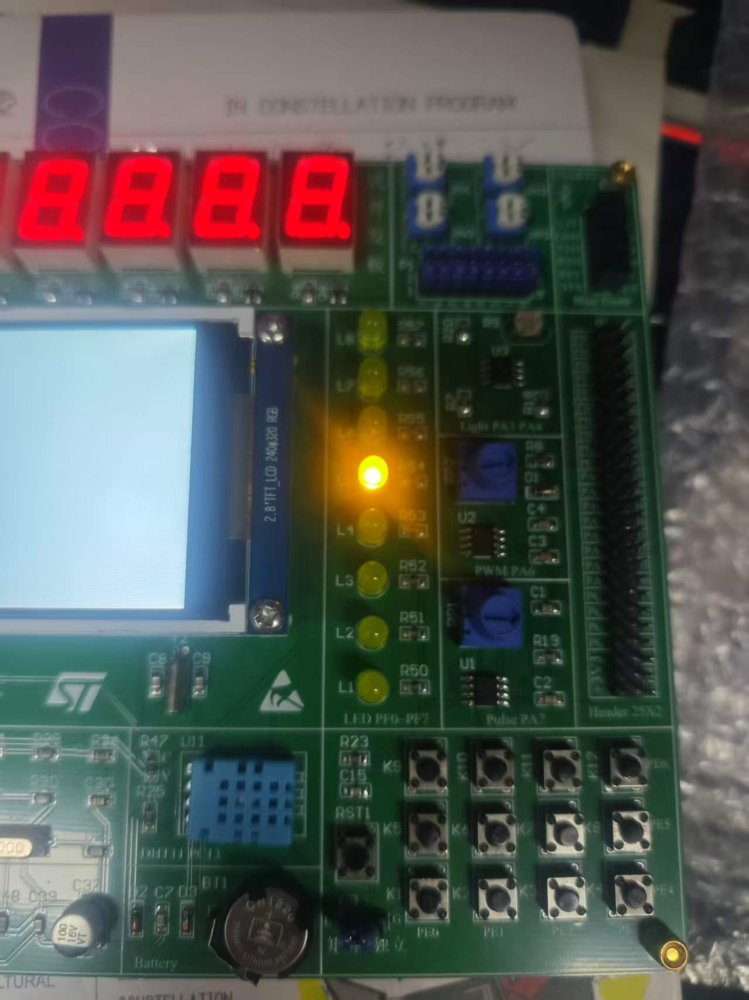
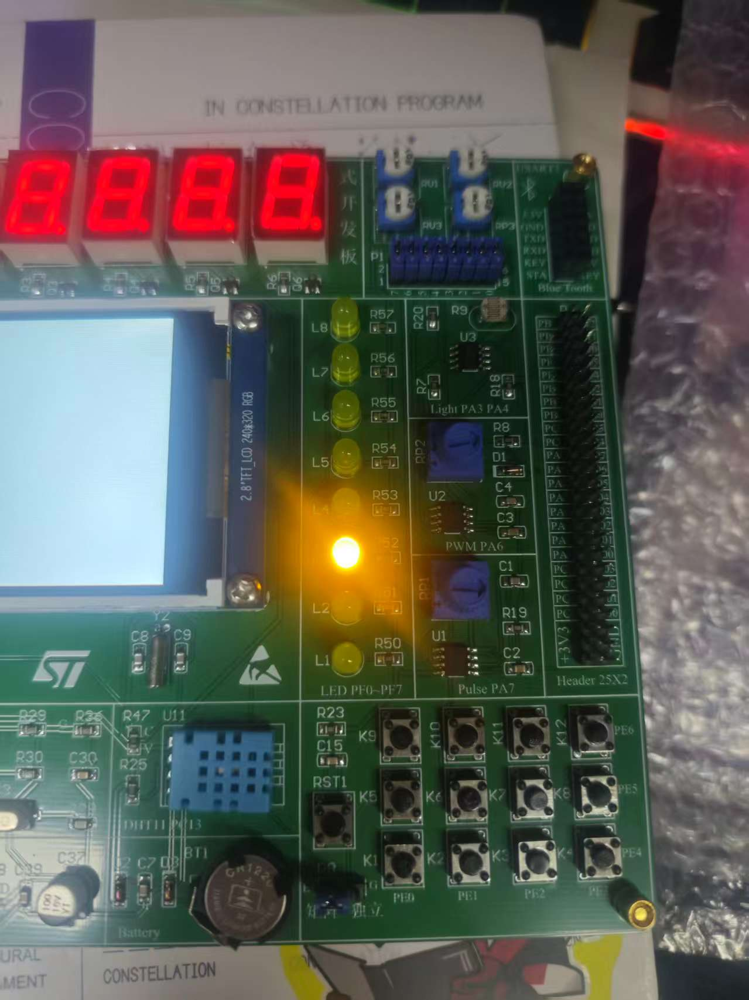

# 实验 1：LED 流水灯

> 姓名：**周靖坪**
> 班级：**24电信一班**
> 学号：**2411020043**

## 一、实验目的

1. 熟悉 STM32CubeIDE 工程创建、编译、下载与调试流程；
2. 掌握 GPIO 输出模式的配置方法（推挽输出、输出速度）；
3. 使用寄存器直接操作 `GPIOF->ODR`，实现 8 个 LED 的流水灯效果。

## 二、实验环境

- 开发板：STM32F407 开发板
- 主控芯片：STM32F407ZET6（Cortex-M4，168 MHz）
- 开发工具：STM32CubeIDE
- 调试器：ST-Link（SWD）
- 工程文件：`code/0501_LEDWater.ioc`（STM32CubeMX 配置）

## 三、硬件连接

| 器件 | 引脚 | 说明 |
| --- | --- | --- |
| LED1 ~ LED8 | PF0 ~ PF7 | 推挽输出，**低电平点亮** |
| 系统时钟 | HSI → PLL | 16 MHz 经 PLL 倍频至 168 MHz |

## 四、原理与设计

1. `MX_GPIO_Init()` 使能 GPIOF 时钟，将 PF0~PF7 配置为推挽输出，初始输出高电平（LED 全灭）。
2. 主循环中依次令 `GPIOF->ODR = ~(1U << i)`（i = 0~7），即只让第 i 位为 0，
   对应 LED 点亮，其余 LED 熄灭，形成流水效果。
3. 每一步调用软件延时函数 `delay(24000000)`，在 168 MHz 主频下约 1 秒。

```c
while (1)
{
  uint8_t i;
  for (i = 0; i < 8; i++)
  {
    GPIOF->ODR = ~(1U << i);   /* 仅第 i 位为 0，其余位为 1 */
    delay(24000000);           /* 软件延时，约 1 秒 */
  }
}
```

延时函数采用空循环实现：

```c
void delay(uint32_t i)
{
  while (i--) { __NOP(); }
}
```

## 五、实验现象

上电后，LED1 ~ LED8 依次点亮并循环，流水间隔约 1 秒；
任意时刻只有一颗 LED 处于点亮状态。实际现象如下图：

| 实验现象 1 | 实验现象 2 | 实验现象 3 |
| --- | --- | --- |
|  |  |  |

## 六、问题与解决

| 问题 | 解决方法 |
| --- | --- |
| LED 亮灭逻辑相反 | 本板 LED 为低电平点亮，`ODR` 对应位输出 0 才亮 |
| 流水速度不稳定 | 软件延时依赖主频，需按 168 MHz 调整循环次数 |

## 七、实验总结

通过本实验掌握了 STM32 GPIO 输出模式配置和直接写 `ODR` 寄存器的用法，
理解了位操作控制单个 IO 的方法，并完成 8 位 LED 流水灯效果。

---

## 文件说明

| 目录/文件 | 说明 |
| --- | --- |
| `code/` | STM32CubeIDE 完整工程（源文件在 `code/Core/Src/`） |
| `report/` | 实验报告 |
| `screenshots/` | 实验现象截图 |
