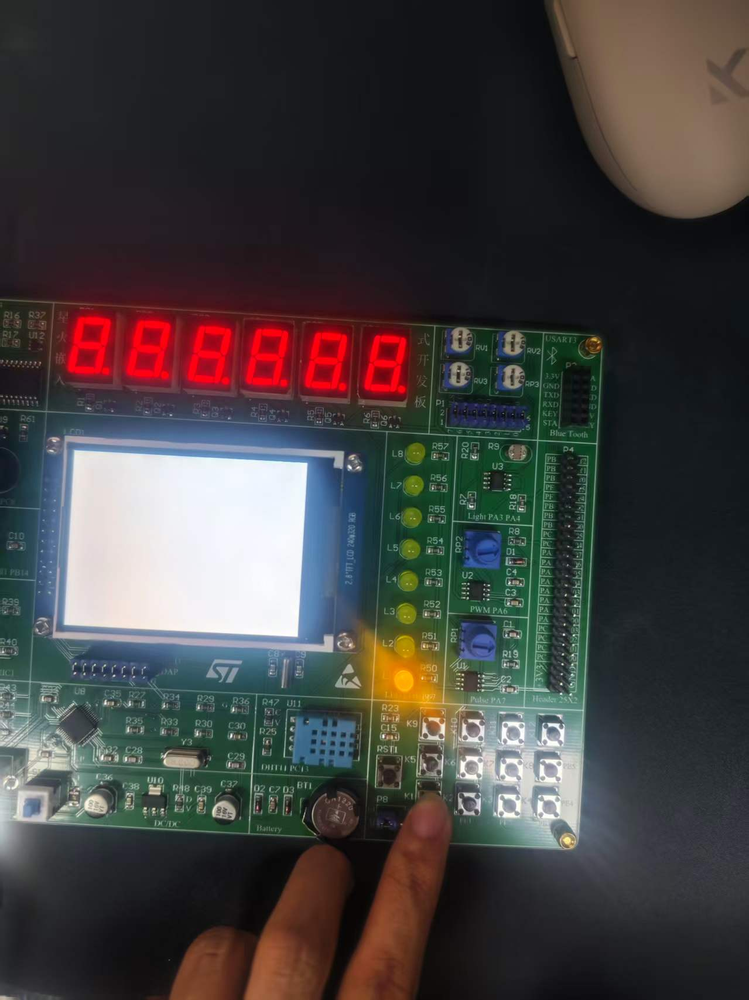
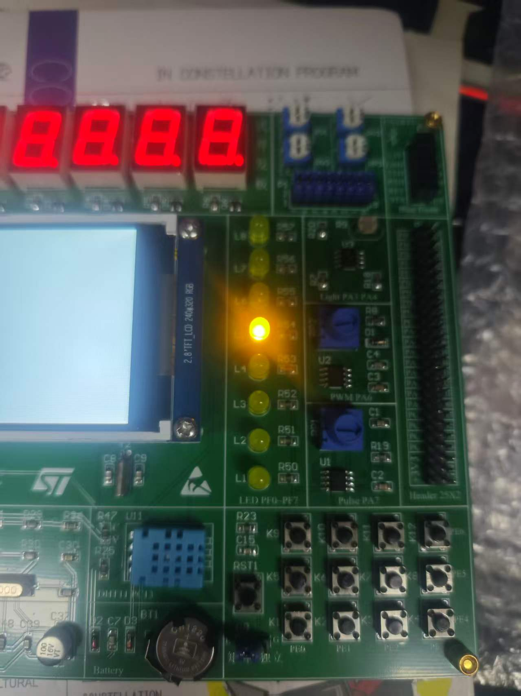
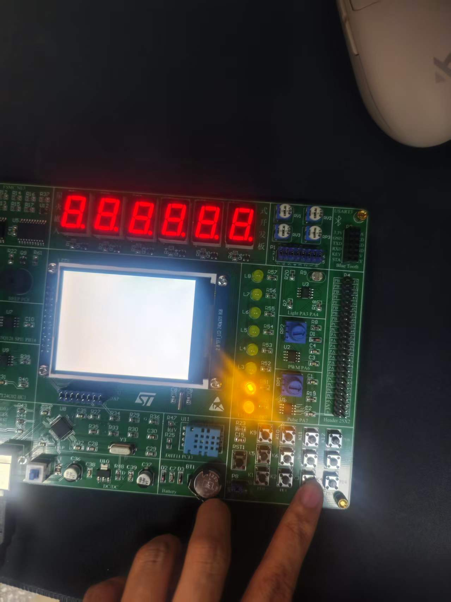
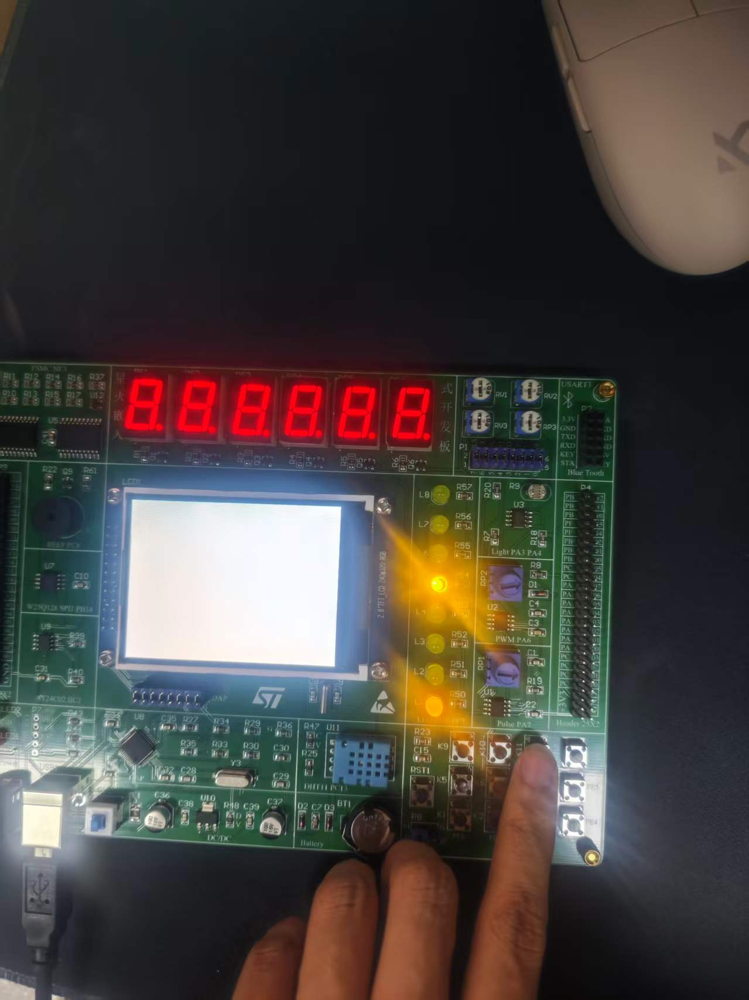
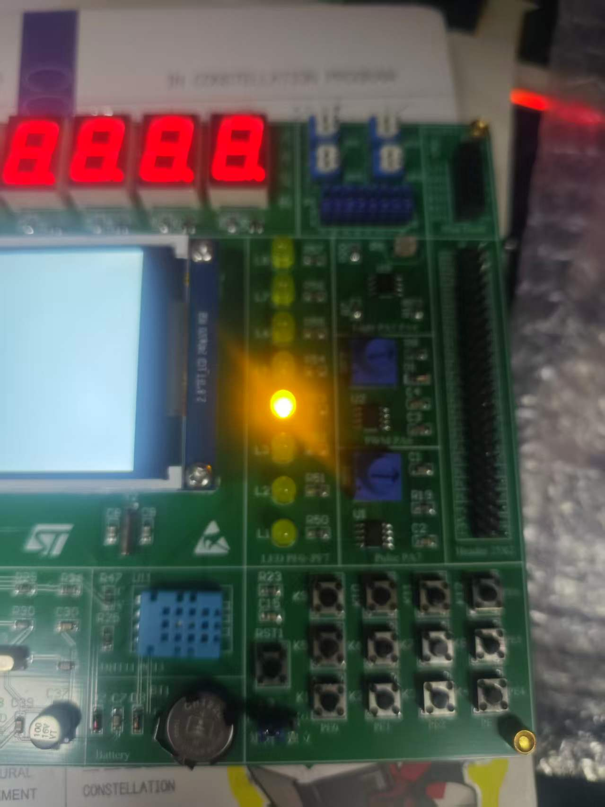

# 嵌入式系统实验报告

## 实验 2：矩阵键盘

| 项目 | 内容 |
| --- | --- |
| 姓名 | 周靖坪 |
| 班级 | 24电信一班 |
| 学号 | 2411020043 |
| 实验日期 | 2026-10-27 |
| 实验环境 | STM32CubeIDE + ST-Link |

## 一、实验目的

1. 掌握矩阵键盘的行扫描原理；
2. 掌握 GPIO 输入（上拉）与输出（推挽）的混合配置；
3. 使用寄存器读写 `IDR` / `ODR` 实现 3×4 矩阵键盘扫描、消抖与键值显示。

## 二、实验原理

矩阵键盘由 3 行 × 4 列共 12 个按键组成，行线与列线交叉形成按键节点。

扫描方法：依次将每一行输出低电平（其余行输出高电平），读取 4 根列线的电平。
若某列读到低电平，说明该行与该列交叉处的按键被按下。
读取 `GPIOE->IDR & 0x0F`，结果不为 `0x0F` 表示有键按下；四种非全高值
`0x0E / 0x0D / 0x0B / 0x07` 分别对应第 1~4 列。

键值按 `KeyVal = 4 × 行号 + 列号` 计算（1~12）。由于行扫描顺序与物理行号不同，
用数组 `PreLine[3] = {2, 0, 1}` 做映射。

消抖：检测到按下后调用 `HAL_Delay(16)` 延时 16 ms，再复测 `IDR`，仍为按下才确认有效。

显示：将键值拆成十位与个位，`GPIOF->ODR = ~((KeyVal / 10 << 4) + KeyVal % 10)`，
PF4~PF7 显示十位、PF0~PF3 显示个位，LED 低电平点亮。

## 三、硬件连接

| 器件 | 引脚 | 说明 |
| --- | --- | --- |
| 列线 COL1~COL4 | PE0 ~ PE3 | 输入，内部上拉 |
| 行线 ROW1~ROW3 | PE4 ~ PE6 | 推挽输出 |
| 键值显示 LED | PF0 ~ PF3（个位）、PF4 ~ PF7（十位） | 推挽输出，低电平点亮 |

## 四、软件设计

1. `MX_GPIO_Init()`：使能 GPIOE、GPIOF 时钟；PE0~PE3 配置为上拉输入，
   PE4~PE6 配置为推挽输出，PF0~PF7 配置为推挽输出；
2. 主循环进行 3 行扫描：读列线 → 判断/消抖 → 计算键值 → 切换到下一行；
3. 循环结束后把键值以 BCD 码输出到 PF 口显示。

关键代码见 `code/Core/Src/main.c` 与 `code/Core/Src/gpio.c`。

## 五、实验现象

依次按下 12 个按键，PF0~PF7 指示 LED 以 BCD 码显示对应键值 1~12，
不同按键对应不同的 LED 点亮组合，松开按键后保持最后按下的键值。
实验现象截图如下（完整图片见 `screenshots/` 目录）：

| | |
| --- | --- |
|  |  |
|  |  |
|  |  |
|  |  |

## 六、问题与解决

| 问题 | 原因 | 解决方法 |
| --- | --- | --- |
| 按键抖动导致误判 | 机械按键存在抖动 | 16 ms 延时后复测确认 |
| 键值与物理位置不符 | 行扫描顺序与行号映射 | 使用 `PreLine[]` 校正 |
| 列线读数始终为高 | 列线未启用上拉 | 配置 `GPIO_PULLUP` 上拉输入 |

## 七、实验总结

通过本次实验理解了矩阵键盘行扫描的工作过程，掌握了利用寄存器直接读取输入、
控制输出的方法，并实现了 12 键键值识别与 BCD 码显示，加深了对 GPIO 输入输出
配置和软件消抖的理解。

## 附：工程与资料

- 工程：`code/`（`0602_MatrixKey.ioc` 为 CubeMX 配置）
- 截图：`screenshots/`
